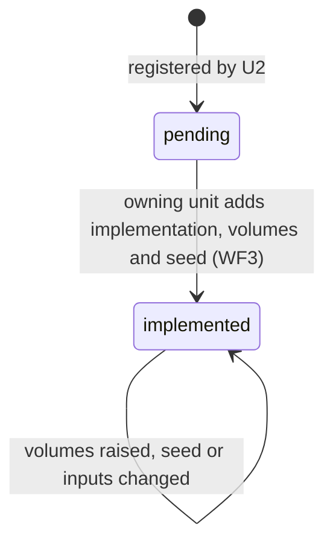
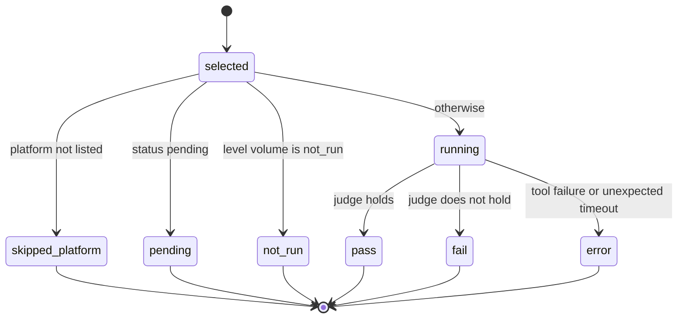
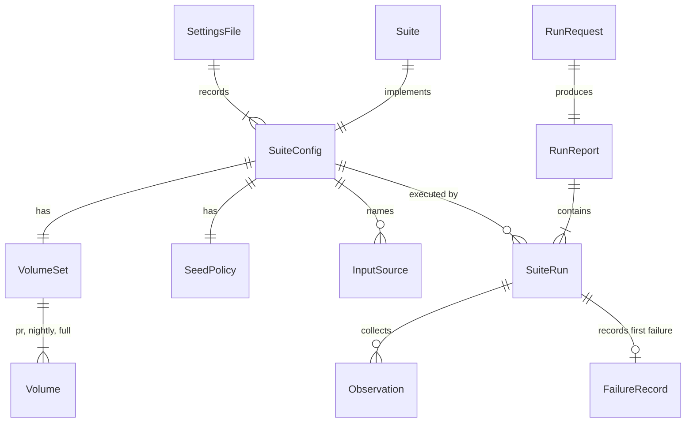

# Functional Specification — acceptance-harness (U2)

The acceptance harness automates the spec's 14 acceptance suites (FR57). It is project tooling, never shipped: a library and a `rail-accept` program added to the test-only `rail-testkit` crate [Q2]. It reads the recorded suite settings from `tests/acceptance/suites.toml` [Q1] [Q9], runs each suite at the requested level, drives `rail` only through its command line and its protocol, and writes a deterministic results file [Q8]. It owns no suite content. Later units register their suites through contract C9 before they write their own code (tests first).

This file is the source of truth for the harness's workflows and state machines. The data shapes are in `entities.md` and the decision logic in `rules.md`. The ER diagram and rules summary below are derived views of those two files.

Sources: `unit-of-work.md` (U2 definition and boundaries), `unit-of-work-story-map.md` (FR57 → U2; each unit adds its suites first), `requirements.md` (FR57, FR27, FR58, NFR1, NFR3, NFR6, NFR7.2, NFR9, NFR10), `components.md` (AcceptanceHarness depends on Cli, RapServer and BenchmarkCorpus; entities SuiteConfig and SuiteRun), `contract-summary.md` (C9 suite registration, C10 corpus layout, E1 RAP, E2 command line), the rAiL spec §12, the team practices, and `functional-design-questions.md` ([Q1]–[Q9]).

## The suites

The harness registers all 15 suites now [Q6]. Full volumes are recorded from spec §12 now. Each owning unit sets the pull-request and nightly volumes in its own design [Q4]. Owning units come from `unit-of-work.md`.

| Suite | Property (spec §12) | Owning unit | Drivers | Build | Cross-platform | Full volume recorded now | Status at U2 |
|---|---|---|---|---|---|---|---|
| S0 | Walking-skeleton smoke (not in spec §12) | U1 | cli, rap | debug | no | count 1 (the seven skeleton steps) | implemented |
| T1 | Deterministic parsing | U3 | cli | debug | yes | count 1,000,000 generated modules, each with one single-byte mutation, each parsed twice | pending |
| T2 | Unique spelling | U3 | cli | debug | no | exhaustive over every §2.7 rule (variants per rule set by U3) | pending |
| T3 | Deterministic builds | U10 | cli | release | yes | exhaustive over the corpus, built twice per platform | pending |
| T4 | Lossless round trips | U3 | cli | debug | no | exhaustive over the corpus and std library, plus count 100,000 generated modules | pending |
| T5 | Stable source maps | U5 | rap | debug | no | count 10,000 single-definition patches | pending |
| T6 | Localized agent edits | U5 | rap | debug | no | count 500 scripted edit tasks | pending |
| T7 | Cross-platform consistency | U8 | cli | debug | yes | exhaustive over the corpus with fixed inputs, seeds and replay logs | pending |
| T8 | Unsafe and inefficient code detection | U13 | cli | debug | no | count 600 programs (300 seeded defects, 300 clean controls) | pending |
| T9 | Functional correctness | U7 | cli | debug | no | exhaustive over std and corpus tests, plus count 10,000 generated inputs per corpus program | pending |
| T10 | Memory safety | U7 | cli | sanitizer | no | exhaustive over the corpus under sanitizers, plus count 24 CPU-hours of std parser fuzzing | pending |
| T11 | Bounded resource use | U15 | cli | debug | no | count 100 adversarial programs | pending |
| T12 | Capability enforcement | U7 | cli | debug | no | exhaustive over every `std.fs/net/proc/env` operation outside its grant | pending |
| T13 | Performance targets | U17 | cli | release | reference machines | exhaustive over the §11.2 targets, on the reference machines only | pending |
| T14 | Minimal dependency operation | U10 | cli | release | no | exhaustive over hello-world and the full corpus, offline | pending |

Two volumes combine a set and a count (T4, T9, T10). The settings file records them as two entries under the same level (one exhaustive, one count). The ratchet (BR2.1, BR2.4) compares each entry separately, and an entry's unit of measure and set never change once recorded.

The Build column is a starting value the owning unit confirms when it implements the suite; T3 and T13 need a release build of `rail` because they judge release artifacts and release performance, T14 because it runs the binary a user would install, and T10 needs the sanitizer build on the pinned nightly toolchain (BR3.6). T3's "per target and mode" means the modes of `rail build` that the suite exercises, not how `rail` itself was built.

## Workflows

### WF1 — Run the harness (`rail-accept --level <pr|nightly|release> [--suite <id>]... [--seed <n>] [--rail <path>]`)

1. Parse the arguments. Stop with a usage error (exit 2) on anything invalid (BR3.3).
2. Read and validate `tests/acceptance/suites.toml` (BR1.1–BR1.7). Check that the settings agree with the registered implementations (BR6.1). Stop with a settings error (exit 2) on the first problem, naming the file, line and key.
3. Find the builds of `rail` the selected suites need (debug, release, sanitizer): build each once with `--locked`, or use `--rail <build>=<path>` (BR3.6, BR5.3).
4. Detect the platform (macos or linux). Read `--reference-machine`, if given, and check it names a recorded reference machine (BR3.5).
5. For each selected suite, in order S0, T1..T14:
   1. If the platform is not listed, record `skipped_platform` (BR3.2).
   2. If the suite is pending, record `pending (<owning unit>)` (BR6.2).
   3. If the level's volume is `not_run`, record `not_run` with its reason (BR3.4). If the suite is T13 and no reference machine was declared, record `not_run` with "not a reference machine" (BR3.5).
   4. Otherwise choose the volume and seed for the level (BR3.1). Print a fresh seed before starting (BR4.1).
   5. Call `generate_inputs(seed, volume)`. For each input, in order, call `run(input)`. Each call starts `rail` through the command line or the protocol with a deadline (BR5.1, BR5.2) and returns an Observation.
   6. Call `judge(observations)` to get pass or fail. A harness or tool failure gives `error` (BR7.1). For a cross-platform suite, also write the normalized observations file for the later comparison (BR7.7).
   7. On fail or error, record the first failing input and the rerun command, and print both (BR4.2, BR7.3).
   8. Continue with the next suite whatever the outcome (BR7.5).
6. Work out the overall result. At the release level, any `pending` or `not_run` suite makes it fail (BR6.3).
7. Write the results file to `target/acceptance/results-<level>.json` (BR7.2), then print the terminal summary, with timings (BR7.6). If no selected suite ran, say so (BR7.4).
8. Exit 0, 1 or 2 (BR7.4).

### WF2 — Check the ratchet (`rail-accept --check-ratchet <base settings file>`)

CI runs this on every pull request. The base file is the version on `main`.

1. If there is no base file (the pull request that introduces `suites.toml`), pass with a notice (BR2.5).
2. Read and validate both files (BR1). Fail if their schema versions differ and the harness has no comparison for that pair (BR2.5).
3. For every suite in the base file, check that it still exists and has not gone from implemented back to pending (BR2.2).
4. For every suite, level and volume entry, check that the new value is not lower than the base value (BR2.1).
5. Check that no unit of measure or exhaustive set changed, no volume entry, input source or platform was removed or replaced, no build changed and no process deadline was lowered (BR2.4).
6. Print a notice for each changed pull-request seed and each added entry, input source or platform (BR2.3).
7. Exit 1 on any failure, naming the suite, field, old value and new value. Otherwise exit 0.

### WF3 — A unit adds its suite (contract C9, tests first)

1. At the start of its Construction, the owning unit implements `generate_inputs`, `run` and `judge` for its suite, and registers the implementation under the suite's id.
2. In the same change it sets the suite's status to `implemented` and records the pull-request and nightly volumes, plus the pull-request seed if the suite uses one (BR6.4, BR1.4). It chooses those volumes in its own design [Q4].
3. The suite runs and fails on the unit's branch, because the unit's code does not exist yet.
4. The unit writes its code until the suite passes. The branch merges only when CI is green on macOS and Linux, including the ratchet check (WF2).

### WF3a — Compare platforms (`rail-accept --compare <results file> <results file> [...]`)

1. Read the given results files. They must all be for the same level.
2. For each cross-platform suite (T1, T3, T7), require one results file per platform the suite lists, then compare the platforms' normalized observation files byte for byte. The first differing input fails the suite (BR7.7).
3. For T13, require a passing results file from every recorded reference machine (BR3.5).
4. In CI, each platform's job keeps its results and observation files, and one final job runs `--compare`. At release, the owner copies the files from each machine and runs `--compare` once.
5. Exit 1 on any difference or missing file, otherwise 0.

### WF4 — Reproduce a failure

1. A nightly or release run fails. Its output and results file contain the seed and the exact rerun command (BR4.1, BR4.2).
2. The developer runs that command. Because inputs depend only on seed and volume (BR4.3), the same input fails first again, on either platform.
3. The fix comes with a test that reproduces the defect (firm rule). The failing input can become a fixed input of the suite.

### WF5 — The walking-skeleton check (S0)

1. S0 runs the seven walking-skeleton steps (check, run, protocol session, broken module refused, recovery after a malformed message, byte-identical builds, shared golden files) at every level on both platforms (BR8.1).
2. `scripts/verify-skeleton.sh`, the recorded checkpoint verification command, becomes a thin wrapper around `rail-accept --level pr --suite S0`. It keeps printing one PASS or FAIL line per step and exits 0 only when S0 passes (BR8.2).

### WF6 — CI levels

| Level | Where it runs | Command | Pending suites | Seeds |
|---|---|---|---|---|
| pr | every pull request, GitHub-hosted macOS and Linux | `rail-accept --level pr` on each platform, then `--compare` and `--check-ratchet <main's file>` | reported, not failures | recorded |
| nightly | nightly workflow, both platforms | `rail-accept --level nightly` on each platform, then `--compare` | reported, not failures | fresh, printed |
| release | the owner's machines, before a release tag | `rail-accept --level release [--reference-machine <id>]` on each machine, then `--compare` over all of them | failures | fresh, printed |

## State machines

### SuiteConfig.status

<!-- Text fallback: a suite starts pending when U2 registers it. It moves to implemented once, when its owning unit adds the implementation, volumes and seed together. There is no way back: the ratchet refuses implemented to pending (BR2.2). An implemented suite can only have its volumes raised or its seed and inputs changed. -->

There is no transition from `implemented` back to `pending`, and a suite is never removed (BR2.2).

### SuiteRun.outcome

<!-- Text fallback: each selected suite ends in exactly one outcome. It is skipped_platform if the host is not listed, pending if not implemented, not_run if its volume at this level is not_run, and otherwise it runs and ends as pass, fail (the pass criterion does not hold) or error (the harness or rail could not produce an observation). -->

## Entity relationships (derived from `entities.md`)

<!-- Text fallback: the settings file records every SuiteConfig. Each SuiteConfig has one VolumeSet (pull-request, nightly and full volumes), one SeedPolicy and its input sources, and is implemented by one registered Suite. A RunRequest produces one RunReport, which contains one SuiteRun per selected suite. Each SuiteRun executes one SuiteConfig, collects Observations, and has a FailureRecord when it fails or errors. -->

## Rules summary (derived from `rules.md`)

| Group | Rules | Summary |
|---|---|---|
| Settings | BR1.1–BR1.7 | Strict TOML, every suite once in order, full volumes always present, pending suites have only full volumes, implemented suites have inputs, volumes rise from level to level, paths stay in the repository, only macOS and Linux. |
| Ratchet | BR2.1–BR2.5 | No volume lowered; no suite removed or reverted to pending; no unit of measure, set, input, platform or build changed or removed; deadlines never lowered; seed changes and additions are reported; a missing base file starts the ratchet. |
| Levels | BR3.1–BR3.6 | pr uses the recorded seed and volume; nightly and release use fresh seeds; suites skip unlisted platforms; `not_run` levels are recorded; T13 counts only on declared reference machines; each suite runs against its recorded build of `rail`. |
| Seeds | BR4.1–BR4.3 | Fresh seeds printed first; every failure prints its rerun command; inputs depend only on seed and volume. |
| Black box | BR5.1–BR5.3 | Command line and protocol only; one suite registry in rail-testkit with no compiler-crate dependency (rail-json allowed); recorded per-suite deadlines; the workspace's own builds by default. |
| Registration | BR6.1–BR6.4 | Settings and implementations agree; pending suites don't block everyday CI but always fail a release; a suite lands with its settings in one change. |
| Reporting | BR7.1–BR7.7 | One outcome per suite; deterministic JSON results; first failing input recorded; exit codes 0/1/2; failures don't stop other suites; only the program prints; cross-platform suites compared across platforms' observation files. |
| Contract and spec | BR9.1–BR9.2 | Spec §12 and contract C9 are updated in the same pull request as the harness. |
| Smoke suite | BR8.1–BR8.2 | S0 is the skeleton check at every level; the approved verification command keeps its meaning. |

## Error handling

| Situation | What happens | Exit code |
|---|---|---|
| Bad arguments | Usage error naming the argument (BR3.3) | 2 |
| Settings file missing, invalid or inconsistent with registrations | Settings error with file, line and key; no suite runs (BR1, BR6.1) | 2 |
| `rail` does not build | Tool error; no suite runs (BR5.3) | 2 |
| A suite's criterion does not hold | `fail`, first failing input and rerun command recorded; other suites continue (BR7.3, BR7.5) | 1 |
| `rail` crashes, hangs past its deadline, or the harness cannot observe a result | `error`, recorded separately from `fail` (BR5.2, BR7.1) | 1 |
| Release run with a pending or `not_run` suite | overall `fail` (BR6.3) | 1 |
| Ratchet lowering or narrowing | Ratchet failure naming suite, field, old and new value (BR2.1, BR2.2, BR2.4) | 1 |
| Cross-platform difference, missing platform file, or missing reference machine | Compare failure naming the suite and first differing input (BR7.7, BR3.5) | 1 |

## Testing implications (tests first)

The harness's own tests are written first and fail before the harness code exists:

- **Settings:** one test per BR1 rule with a small invalid settings file; each must fail with the named error and exit 2. A valid file with all 15 suites must load.
- **Ratchet:** pairs of base and new files for each lowering kind (count down, exhaustive to count, count to not_run, volume entry removed, unit of measure changed, exhaustive set changed, input source removed or replaced, platform removed, build changed, deadline lowered, suite removed, implemented to pending) must fail; raising volumes, adding entries and inputs, and changing seeds must pass with the right notices; a missing base file passes with its notice; differing schema versions fail.
- **Builds and reference machines:** a fake suite recording each build gets the matching `rail`; T13 without `--reference-machine`, or with an unlisted id, is `not_run`; T13 or T14 recorded with a non-release build is a settings error.
- **Compare:** two results files with identical observation files pass; a one-byte difference fails naming the first differing input; a missing platform or reference machine fails.
- **Registry:** a test reading `rail-testkit`'s `Cargo.toml` fails if a compiler crate is added to its normal dependencies.
- **Levels and seeds:** a fake suite registered in the tests records the volume and seed it was given at each level; `--seed` overrides; a fresh seed is printed before inputs are generated.
- **Determinism:** the same report written from two directories is byte-identical; every registered generator returns identical inputs for the same seed and volume.
- **Outcomes:** fake suites that pass, fail, error, time out, and are pending, `not_run` or on another platform produce the right outcomes and exit codes at each level, including the release rule.
- **Black box:** S0 against the real `rail` passes on macOS and Linux; `scripts/verify-skeleton.sh` still prints its step lines and exit codes.

Coverage counts toward the Rust floor except where NFR9 excludes test harnesses. The harness is test tooling, so the exclusion applies, but its own logic is still tested as above.

## Assumptions & Open Questions

- [assumption] The authoritative spec is supposed to live in a `spec/` folder in the repository (team practice, FR58), but no `spec/` folder exists yet; the spec is only in the knowledge folder. The spec updates this unit depends on (three recorded volumes, macOS and Linux only, scaled CI volumes per FR58.1) need that folder, or an agreed place, before this unit's code change lands.
- [assumption] "Pending (owning unit)" suites and `not_run` levels count as passes for the exit code at pull-request and nightly levels only (BR7.4); they always fail a release (BR6.3).
- [assumption] Declaring a reference machine with `--reference-machine` is the owner's own statement; the harness checks the id against the recorded list but does not verify the hardware. U17 records the machines and T13's pull-request and nightly volumes (expected `not_run`).
- [assumption] Observation files for cross-platform suites at full volume can be large; comparing them byte for byte is the first design. A digest could replace the files later, but it would need a hash function, which means an approved crate or U9's own primitives.
- Open question for U3: the number of generated variants per §2.7 rule in T2's full volume. The spec gives none.
- Open question for U7: how T10's 24 CPU-hours map onto the release machines. Because the unit of measure can never change once recorded (BR2.4), U2 records T10's fuzz entry in CPU-hours, and U7 records its pull-request and nightly fuzz volumes as a separate entry if it needs finer units.
- Open question for U10: how T3's variation of directories, users, clocks and core counts is produced. The harness runs each build in a fresh working directory and can set environment variables; varying the user or system clock needs the release machines or U10's own tooling.

## Contract C9 amendment (applied in the harness pull request, BR9.2)

| C9 field today | After the amendment |
|---|---|
| path: `tests/acceptance/suites.toml or canonical text equivalent` | `tests/acceptance/suites.toml` (TOML, read with the approved `toml` + `serde` crates) |
| `ci_volume`, `full_volume` | `volumes.pr`, `volumes.nightly`, `volumes.full`, each a list of entries (count, exhaustive over a named set, or not_run), with `unit_of_measure` |
| (none) | `status`, `owning_unit`, `drivers`, `build`, `process_deadline_seconds`, `cross_platform`, and the file-level `reference_machines` |
| rule: lowering ci_volume is lowering a pass criterion | the ratchet rules BR2.1–BR2.5, checked on every pull request |
| suite_interface: generate_inputs, run, judge | unchanged; implementations live in `crates/rail-testkit/src/suites/<id>.rs` and register in rail-testkit's static registry |
