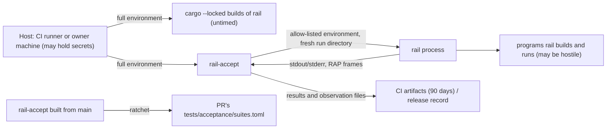

# Security Design — acceptance-harness (U2)

How the harness meets its quality requirements. The requirements are in `security-requirements.md` (NFR Requirements); the behaviour they protect is in `functional-spec.md` and `rules.md` (Functional Design). This is a library unit, so this file also holds the design for the harness's time budgets, determinism and retention. There is no separate performance or reliability design document.

## Sources

- `security-requirements.md`: NFR1.4, NFR3.6, NFR3.7, NFR5.7, NFR5.8, NFR7.7, NFR9.15–NFR9.18, NFR10.3, NFR10.4.
- `tech-stack-decisions.md`: the harness in `rail-testkit`, `toml` + `serde`, `rail-json` for results, `/dev/urandom` seeds, the in-house input generator.
- `functional-spec.md`: workflows WF1–WF6, the suite table, the C9 amendment.
- `contract-summary.md`: C9 (suite registration), E1 (RAP), E2 (command line).
- `nfr-design-questions.md` [Q1]–[Q4], confirmed.

## Trust boundaries and controls

<!-- Text fallback: the host's full environment reaches only the cargo builds and the rail-accept program itself. rail-accept starts each rail process with an allow-listed environment and a fresh run directory; rail may run hostile programs. rail's output flows back to the harness, which parses it strictly. A rail-accept built from main checks the pull request's settings file. Results and observation files go to CI artifacts for 90 days, or to the release record. -->

| Boundary | Threat | Control | Requirement |
|---|---|---|---|
| Host → `rail` process | A secret in the host environment reaches `rail` or a hostile program | Environment cleared, then the allow-list set | NFR5.7 |
| `rail` → file system | A hostile program writes outside its run | Fresh run directory per suite run; repository never the working directory | NFR5.8 |
| `rail` output → harness | Malformed or huge output crashes or stalls the harness | Strict `rail-json` parsing (bounded depth, never panics); deadlines per process; `error` outcome | BR5.2, BR7.1 |
| Pull request → settings file | A pull request lowers or narrows what suites check, or weakens the ratchet itself | Ratchet built from `main` | NFR9.15 |
| Run → evidence | A flaky pass hides nondeterminism; a hosted run poses as a reference machine | No retries; recorded reference-machine ids | NFR3.6, NFR1.4 |

## Boundary 1 — the environment of `rail` processes (NFR5.7, NFR10.3) [Q2] [Q3]

- The testkit's process runner calls `env_clear()` on every `Command` that starts `rail`, then sets exactly `PATH` (copied from the harness), `LANG=C.UTF-8`, `TZ=UTC`, `HOME=<run dir>/home` and `TMPDIR=<run dir>/tmp`.
- A suite may add variables only as literal name and value pairs in its own code (for example `RAIL_THREADS=1` for a T3 variation). The runner offers no way to copy a variable from the host, so a secret cannot be passed on by mistake. [Q3]
- Suites that make `rail` link programs need nothing more. `rail build` calls `cc`, which finds the platform SDK through `PATH`. If a platform turns out to need a linker variable, the suite adds it as a literal and never copies it from the host.
- The cargo builds of `rail` (debug, release, sanitizer) are started by `rail-accept` with its own environment, so `HOME`, `CARGO_HOME`, `RUSTUP_HOME` and the macOS SDK variables reach cargo. The builds finish before any suite starts and before the budget clock starts. [Q2]
- The process-runner test starts a helper that prints its environment, with `RAIL_TEST_SECRET` set on the harness, and checks that the output is exactly the allow-list.

## Boundary 2 — run directories (NFR5.8)

- Each suite run creates `rail-accept-<suite>-<n>` under the system temporary directory using the testkit's `TempDir`. Inside it: `home/`, `tmp/` and `work/`. Suite inputs are copied into `work/`, and `rail` runs with `work/` as its current directory.
- On `pass`, `pending`, `not_run` and `skipped_platform`, the directory is removed. On `fail` or `error`, it is kept and its path is printed in the terminal summary. The path never enters the results file (BR7.2).

## Boundary 3 — the ratchet's own trust (NFR9.15) [Q4]

- The pull-request workflow checks out `main` into a separate directory, builds `rail-accept` there with `--locked`, and runs `rail-accept --check-ratchet <main's suites.toml> --against <PR's suites.toml>`. The ratchet that judges a pull request is the one already reviewed and merged.
- When `main` has no `tests/acceptance/suites.toml` or no `rail-accept` (the pull request that first adds the harness), the job passes with the notice "no base harness; the ratchet starts after this merge" (BR2.5).
- The same job reports any change to budgets or nightly groups as a notice (see Time budgets).

## Boundary 4 — evidence integrity (NFR1.4, NFR3.6, NFR3.7, NFR10.4)

- **No retries (NFR3.6).** The run loop calls each selected suite once. There is no retry option in the command line or the settings file, and the CI workflows call `rail-accept` once per level or group, with no re-run step.
- **Deterministic results (NFR3.7).** The results file is built as a `rail-json` value with fields in a fixed order and runs ordered S0, T1..T14, then written with no whitespace. Paths in it are repository-relative. Elapsed times, run-directory paths and the drawn seed's source are printed only to the terminal. The seed value itself is in the results, because a rerun needs it.
- **Reference machines (NFR1.4).** `--reference-machine <id>` is checked against `reference_machines` in the settings file before any suite runs. The id, not the hostname, is written into the results. `--compare` requires a passing T13 result from every listed id.
- **Retention (NFR10.4).** The CI workflows upload `target/acceptance/` with `actions/upload-artifact` (pinned to a commit, as the other actions are), `retention-days: 90` and `if: always()`, so a failed run's results are kept too. A run cut off by the job timeout still uploads whatever the harness wrote before. The release checklist attaches the release-check results files and the `--compare` output to the release's build record.

## Time budgets (NFR9.16, NFR9.17, NFR9.18) [Q1] [Q2]

- **Where budgets and groups are recorded.** The settings file gains a `[budgets]` table (`pr_minutes = 10`, `nightly_group_minutes = 300`) and a `nightly_group` field on every implemented suite. These are additions to the settings schema of Functional Design (`entities.md` SuiteConfig) and to the C9 amendment (BR9.2), made in the harness pull request. `rail-accept` reads its budget from the settings file for the level; workflows pass no budget of their own, so a workflow edit cannot quietly change one. The release check has no budget.
- **Groups without parsing workflow files.** `rail-accept --list-groups` prints the nightly group names from the settings file as a JSON array. The nightly workflow's first job runs it and feeds the output to the matrix of the second job (`fromJSON`), which calls `rail-accept --level nightly --group <name>`. The settings validation requires every implemented suite to name exactly one group (a single field cannot name two). So the harness never needs to read YAML, and no group can be forgotten.
- **Ratchet on budgets.** The ratchet (built from `main`, Boundary 3) prints a notice for any change to `[budgets]` or to a suite's `nightly_group`, so the change is visible in review. Budget changes are not refused: a budget is a speed target, not a pass criterion, and changing it needs your decision (NFR Requirements Q1, Q2).
- **The clock** starts after the builds and settings checks, when the first suite starts [Q2]. Before each suite, the scheduler checks the remaining budget. While a suite runs, a watchdog thread checks the remaining budget once a second.
- **Stopping at the budget** [Q1]:
  - Suites run on the scheduler thread and start processes only through a run context the harness gives them. When the budget is reached, the watchdog sets the context's stop flag and kills the process group of the process that is running.
  - Every `rail` process is started in its own process group (`CommandExt::process_group(0)`, stable Rust, no `unsafe`). Killing uses `/bin/kill -KILL -- -<pgid>` started as an argument list, so grandchildren that `rail` started (for example a hostile program and its children) are stopped too. The same group kill replaces the existing direct-child kill for per-process deadlines (BR5.2).
  - After a kill, the run context refuses to start any new process. The suite's `run` call returns timed out, and the scheduler records the suite as `error` with "over time budget" and does not call `judge` further. Every suite not yet started is recorded as `not_run` with "budget exhausted". The results file is written and the run exits 1 (BR7.4).
  - Residual risk: a hostile program that deliberately leaves its process group (T11 fork bombs) can survive the kill. Containing that is what T11 checks in the toolchain's own limits. On CI the runner is discarded after the job. On your machines the release check runs without a budget.
- The terminal summary lists each suite's elapsed time and share of the budget, and on an over-budget failure names the three slowest suites.
- The nightly workflow's per-job `timeout-minutes` must be above the 5-hour group budget plus build time and below GitHub's 6-hour limit; 345 minutes is suggested. The current `nightly.yml` value (60) is changed in the CI Pipeline stage.

## Dependency isolation (NFR7.7)

- `toml` and `serde` are listed only under `rail-testkit`'s `[dependencies]`.
- Check: `rail` must not depend on `rail-testkit` through normal (non-dev, non-build) dependency edges, directly or through any other crate. Several compiler crates (`rail`, `rail-build`, `rail-rap`, `rail-tools`) already use `rail-testkit` as a dev-dependency for their tests, which is correct and never reaches the binary. `Cargo.lock` does not record edge kinds, so it cannot be used. Instead a test in `rail-testkit` runs `cargo metadata --format-version 1 --locked`, reads its JSON with `rail-json`, and walks only dependencies whose `dep_kinds` entry has `kind: null` (normal), starting from the `rail` package. It fails if `rail-testkit` is reachable. The test also checks that `rail-testkit` itself is found as a dev-dependency of `rail`, so a check that silently walks nothing cannot pass. It does not look for `serde`, because approved compiler crates such as Wasmtime may use `serde` later.
- `cargo deny check` (licences, advisories, bans, sources) already runs on every pull request and covers the new crates.

## Supply chain and secrets (NFR10.3)

- No secret is needed at the pull-request or nightly level, and no workflow step for the harness reads a secret.
- `gitleaks` and GitHub secret scanning already run on every pull request.
- Reference machine ids are plain names chosen by you, not hostnames.

## Assumptions & Open Questions

- [assumption] `cc` on macOS finds the SDK without `SDKROOT` when started with only `PATH` and a temporary `HOME`. This is tested, not assumed for long: S0 builds and runs `skeleton.answer` through the scrubbed environment on both platforms in every pull request, so a linking failure shows up in the harness pull request itself. If it fails, the fix is a literal variable added by S0 (never copied from the host).
- [assumption] Workflow files are reviewed by you in every pull request like any other change; the harness does not try to detect workflow edits beyond keeping budgets and groups in the settings file.
- [assumption] A one-second watchdog granularity is precise enough for budgets measured in minutes.
- Open question for the CI Pipeline stage: exact nightly group membership, and raising the nightly job timeout to about 345 minutes.
