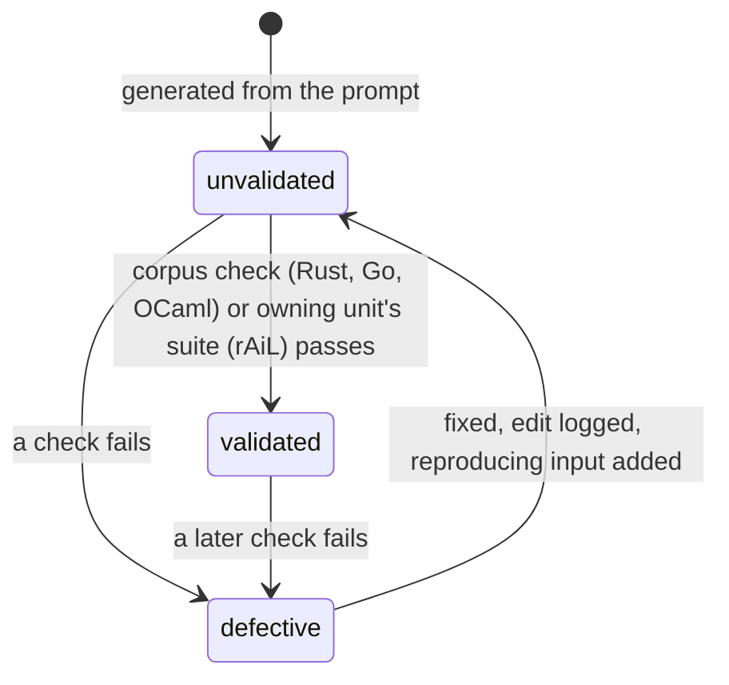
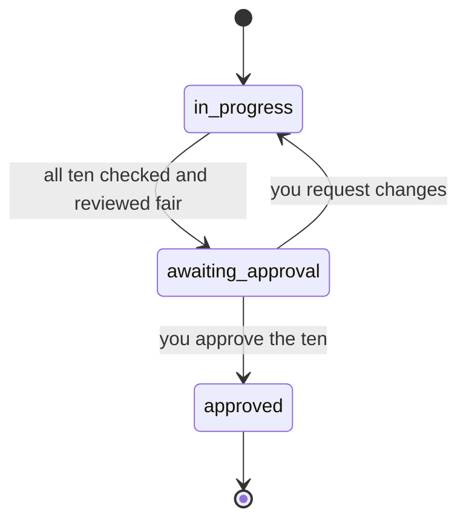
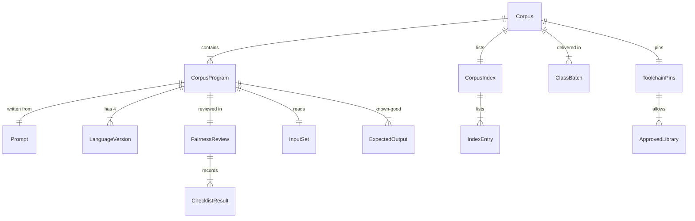

# Functional Specification — benchmark-corpus (U16)

The benchmark corpus is 40 programs in four classes of ten, each written in rAiL, Rust, Go and OCaml under one prompt and reviewed for fairness (FR54, spec §11.1). It lives in `corpus/` at the repository root, outside the toolchain's Cargo workspace. It is input to suites T3, T4, T7, T9, T10 and T13 and to the §11.3 token measurements. This unit writes the corpus and a corpus check that builds and runs the Rust, Go and OCaml versions now. The rAiL versions are written in canonical text straight from the spec and are validated later, as the units that parse, check and run them land.

This file is the source of truth for the corpus's workflows and state machines. The data shapes are in `entities.md` and the decision logic in `rules.md`. The ER diagram and rules summary below are derived views of those two files.

Sources: `unit-of-work.md` (U16 definition, placement before syntax), `unit-of-work-story-map.md` (FR54 → U16), `requirements.md` (FR54, FR58, NFR3, NFR5, NFR6, NFR7), `components.md` (BenchmarkCorpus serves PerfHarness, ModelMeasurement and AcceptanceHarness; entity CorpusProgram), `contract-summary.md` (C10 corpus layout), the rAiL spec §11.1, the team practices, and `functional-design-questions.md` ([Q1]–[Q9]).

## The approved programs

Approved in Q1, delivered in this order (BR9.1).

| Class | Program | Task |
|---|---|---|
| pure-transform | binary-trees | Allocate and walk complete binary trees of given depths; print check sums. |
| pure-transform | fannkuch-redux | Count maximum pancake flips over all permutations of n; print check sum and maximum. |
| pure-transform | n-body | Simulate the five-planet system for n steps; print energy before and after to nine decimals. |
| pure-transform | spectral-norm | Estimate the spectral norm of the infinite matrix A for size n; print to nine decimals. |
| pure-transform | levenshtein-batch | Compute edit distances for a list of word pairs; print one distance per line. |
| pure-transform | knapsack-dp | Solve 0/1 knapsack by dynamic programming; print best value and chosen items. |
| pure-transform | record-sort-dedup | Sort records by key, drop exact duplicates, print the result. |
| pure-transform | run-length-codec | Run-length encode then decode a byte stream; print encoded size and verify round trip. |
| pure-transform | base64-codec | Base64 encode then decode a byte stream; print encoded text length and verify round trip. |
| pure-transform | dijkstra-paths | Shortest paths from a source in a weighted graph; print distances in node order. |
| parsing-text | json-validate | Parse JSON; print it re-serialised canonically, or a located parse error. |
| parsing-text | csv-aggregate | Group CSV rows by a column and sum another; print groups in key order. |
| parsing-text | word-frequency | Count words in a text; print the top k with counts, ties by word order. |
| parsing-text | mini-regex | Match lines against a small regex subset (literals, `.`, `*`, `+`, `?`, `[]`, anchors); print matching lines. |
| parsing-text | markdown-lite | Convert a Markdown subset (headings, paragraphs, emphasis, lists, code) to HTML. |
| parsing-text | ini-config | Parse INI files; print sections and keys, or errors with line numbers. |
| parsing-text | log-analyze | Classify log lines by level and source; print counts per class. |
| parsing-text | expr-calc | Parse and evaluate integer arithmetic expressions with precedence; print results or located errors. |
| parsing-text | utf8-stats | Validate UTF-8 and count characters by general category; print the counts. |
| parsing-text | line-diff | Diff two files line by line by longest common subsequence; print a unified-style diff. |
| io-services | file-checksum | Copy a file to a target and verify the copy by checksum; typed errors for missing or unreadable files. |
| io-services | dir-summary | Walk a directory tree; print file counts and sizes per directory in path order. |
| io-services | kv-log-store | Apply a script of put/get/delete commands to an append-only key-value log file. |
| io-services | config-loader | Load a configuration file, validate required keys and types, print the normalised config. |
| io-services | batch-rename | Rename files matching a pattern, with a dry-run mode; refuse collisions with a typed error. |
| io-services | log-rotate | Rotate log files by size, keeping a fixed number; print what moved. |
| io-services | process-pipeline | Run a fixed helper command as a child process, capture its output and exit status. |
| io-services | env-report | Build a report from named environment variables; typed errors for missing or malformed ones. |
| io-services | csv-to-json-files | Convert each CSV file in a directory to JSON, reporting per-file errors and continuing. |
| io-services | incremental-backup | Copy only files that changed since the last backup manifest; print what was copied. |
| data-parallel | parallel-sum | Sum a large generated array of integers across threads. |
| data-parallel | parallel-histogram | Build a byte-value histogram of a large input across threads. |
| data-parallel | parallel-mandelbrot | Render the Mandelbrot set in tiles across threads, using only correctly rounded binary64 operations in a fixed order; print a checksum of the image. |
| data-parallel | parallel-matmul | Multiply two dense integer matrices across threads; print a checksum. |
| data-parallel | parallel-merge-sort | Sort a large array with a parallel merge sort; print a checksum and sortedness check. |
| data-parallel | parallel-word-count | Count words over shards of a large text; print the top k. |
| data-parallel | parallel-prefix-scan | Compute prefix sums of a large array in parallel; print a checksum. |
| data-parallel | parallel-bfs | Breadth-first search over a large generated graph; print levels per node checksum. |
| data-parallel | parallel-monte-carlo-pi | Estimate pi with seeded per-task integer random streams and an integer hit test; print hits and samples, and pi to six decimals from that ratio. |
| data-parallel | parallel-blur | Apply a 2-D box blur in integer arithmetic to a generated image; print a checksum. |

Only n-body, spectral-norm and parallel-mandelbrot compute in floating point. They use only correctly rounded binary64 operations (add, subtract, multiply, divide, square root) in the order the prompt writes, with no fused multiply-add and no other math-library function, and print with correctly rounded fixed decimals. Every other program uses integers. Parallel programs combine partial results in a fixed order. So all versions agree byte for byte on every platform, and T9's zero-difference criterion holds without any tolerance (BR2.2–BR2.4).

## Workflows

### WF1 — Write one program (BR3, BR6)

1. Write `prompt.md`: the task, the input and output format (byte-exact), the error cases with their `kind` names, and the run contract (arguments only; `--threads` for data-parallel; no environment except where the prompt names it).
2. Generate each of the four versions from the prompt alone plus that language's reference, each in a separate session with the same model. Record the model id and date in `prompt.md`.
3. Write the std-only Rust input generator (`inputs/gen/`, `--seed --size --out <dir>`) and up to eight small fixed inputs (`inputs/fixed/`, at most 64 KiB each). For io-services, the fixed input is a fixture directory or file set; empty directories are created by the generator (BR2.5, BR7.1).
4. Add the program's entry to `corpus/index.toml` with its run data: argument template, input mode, threads flag, generator outputs, size range, reference size, fixed inputs, comparison mode and whether it uses floating point (BR1.4).
5. Produce `expected/` (and, for io-services, `expected/<input>.tree`) from the Rust version through the corpus check's bless mode (BR7.2).
6. Run the corpus check for the Rust, Go and OCaml versions (WF3). Fix any defect in the version at fault, log the edit, and add a fixed input that reproduces it (BR3.4).

### WF2 — Review and approve a class (BR4, BR9)

1. When all ten programs of the class pass the corpus check, an AI reviewer fills in each program's `fairness-review.md` against `corpus/fairness-checklist.md`, naming its model id.
2. Programs with outcome `needs-changes` go back to WF1.
3. When all ten are `fair`, the class becomes `awaiting-approval`, and you are asked to approve the ten together.
4. Your approval and its date are written to `corpus/<class>/APPROVAL.md`. The next class starts.

### WF3 — The corpus check (`corpus/check.sh` driving a std-only Rust checker in `corpus/tools/check/`) (BR1, BR2, BR5, BR7, BR8.1)

1. Read `corpus/toolchains.toml`; stop if an installed toolchain differs from its pin (BR5.3).
2. Read `corpus/index.toml`; check the composition, layout and run data (BR1.1–BR1.4), and the format and uniqueness of every `main.rlc` definition ID (BR3.3).
3. Check every version's manifest against the allowed libraries (BR5.1, BR5.2); `cargo deny check` runs over the corpus Rust packages with `corpus/deny.toml` (BR5.5).
4. Run every generator twice with the same seed and size; the bytes must match (BR7.1). Check fixed input sizes (BR7.3).
5. Build the Rust, Go and OCaml versions offline with the pinned toolchains and vendored libraries.
6. For each fixed input, run each version with its current directory, `HOME` and `TMPDIR` inside a fresh temporary directory holding a copy of its inputs, beside a canary directory. Create the run-time error cases first (permission-denied files; skipped with a notice when running as root) (BR6.5). Compare stdout, exit code and error line with `expected/`, and for io-services the run directory's final tree; check the canary is untouched (BR2.2, BR6.2, BR6.4). For data-parallel programs, run with 1 thread and with the core count (BR2.3). process-pipeline gets the path of the checker-built helper (BR6.6).
7. With `RAIL_BLESS=1`, write `expected/` from the Rust version instead of comparing (BR7.2).
8. Print one line per program and language, and exit 1 on any failure.

CI runs the corpus check on macOS and Linux for every pull request that touches `corpus/`, and nightly (BR8.1).

### WF4 — Validate the rAiL versions as the toolchain grows (BR8.2)

1. U3 (syntax) adds T4 and its corpus parsing checks; every `main.rlc` must parse and round-trip.
2. U4 (checker) checks every `main.rlc`.
3. U6 and U7 (execution, system and standard library) run every rAiL version on the fixed inputs and compare with `expected/` (T9), and later suites use the corpus as their inputs.
4. A rAiL version that fails any of these is a corpus defect: fix it, log the edit, add a reproducing input.

## State machines

### LanguageVersion.validation

<!-- Text fallback: every version starts unvalidated when generated. It becomes validated when the corpus check (Rust, Go, OCaml) or the owning unit's suite (rAiL) passes, and defective when a check fails. A defective version goes back to unvalidated after a logged fix with a reproducing input. -->

### ClassBatch.status

<!-- Text fallback: a class is in progress until all ten programs pass the corpus check and are reviewed fair; then it awaits your approval. Approval completes it; a change request sends it back to in progress. -->

## Entity relationships (derived from `entities.md`)

<!-- Text fallback: the corpus has one index, one set of toolchain pins, four class batches and 40 programs. Each program has one prompt, four language versions, one fairness review, one input set and one or more expected outputs. -->

## Rules summary (derived from `rules.md`)

| Group | Rules | Summary |
|---|---|---|
| Composition | BR1.1–BR1.4 | Exactly the 40 approved programs, ten per class, in the C10 layout, with complete run data in the index. |
| Run contract | BR2.1–BR2.5 | Same input handling; byte-identical, deterministic output; independent of thread count, file-system order and timestamps; correctly rounded floating point only. |
| Authoring | BR3.1–BR3.4 | One prompt, one model, separate sessions; rAiL in canonical text; defect-only, logged edits. |
| Fairness | BR4.1–BR4.2 | Checklist review by an AI reviewer; your approval per class. |
| Libraries and toolchains | BR5.1–BR5.5 | Standard libraries; rayon and domainslib for data-parallel only, pinned and vendored; pinned toolchains; outside the workspace. |
| I/O and errors | BR6.1–BR6.6 | One command-line contract; one typed-error shape; no network; checked confinement with a canary and tree listing; run-time permission cases; one fixed helper. |
| Inputs and outputs | BR7.1–BR7.3 | Seeded generators; Rust-reference outputs via bless; small committed inputs. |
| Validation | BR8.1–BR8.2 | Rust, Go, OCaml checked now on both platforms; rAiL as the toolchain grows. |
| Delivery | BR9.1–BR9.2 | One class at a time, in a fixed order; the spec note lands with the corpus. |

## Error handling

| Situation | What happens |
|---|---|
| Installed toolchain differs from its pin | Corpus check stops with both versions named (BR5.3). |
| A version's output differs from `expected/` | Corpus check fails naming program, language, input and first differing byte (BR2.2). |
| A program crashes instead of reporting a typed error | Defect; fixed with a reproducing input (BR6.2, BR3.4). |
| A data-parallel result depends on thread count | Corpus check fails (BR2.3). |
| A generator is not deterministic | Corpus check fails naming the generator (BR7.1). |
| A rAiL version fails a later unit's suite | Corpus defect, fixed with a reproducing input (BR8.2). |

## Testing implications (tests first)

- The corpus checker (`corpus/tools/check/`) is written tests-first: its own tests cover the composition, layout, manifest, determinism, size and comparison rules on small synthetic corpora before it runs on the real one.
- For each program, the fixed inputs and their expected outputs are the program's tests. They include at least one input per listed error case.
- The rAiL versions have no runnable tests in this unit; their tests are the later units' suites (WF4).

## Assumptions & Open Questions

- [assumption] Go and OCaml (with dune, and opam for vendoring `domainslib`) will be installed on your Mac and in CI before Code Generation. They are not installed now.
- [assumption] The corpus check runs in CI as its own job, not inside the acceptance harness. The harness suites that use the corpus (T3, T4, T7, T9, T10, T13) read `corpus/index.toml` when their owning units implement them.
- [assumption] Generating 160 source programs uses one model across sessions; the model id is chosen at Code Generation time and recorded per program.
- Open question for U17: whether the token measurements need extra per-program metadata beyond `prompt.md` (for example the definition and patch boundaries §11.3 counts).
- Handoff to U6 (execution core) and U12 (release backend): byte-identical floating-point results (BR2.4) require that the rAiL compiler never contracts a multiply and an add into a fused multiply-add, and computes binary64 operations exactly as written. U6's design must state this; otherwise T9 will flag n-body, spectral-norm and parallel-mandelbrot.
- Spec note (BR9.2): §11.1 gains the corpus conventions in the same pull request as the corpus.
