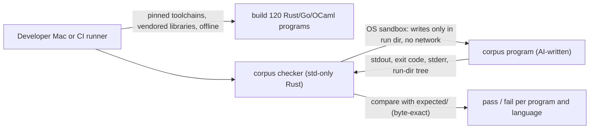

# Security Design — benchmark-corpus (U16)

How the corpus meets its quality requirements. The requirements are in `security-requirements.md` (NFR Requirements), and the behaviour they protect is in `functional-spec.md` and `rules.md` (Functional Design). A unit of kind `spec` has no separate performance or reliability design, so the corpus check's time limits are designed here too.

## Sources

- `security-requirements.md`: NFR3.8, NFR3.9, NFR5.9, NFR6.3, NFR7.8, NFR9.19, NFR9.20, NFR10.5, NFR10.6.
- `tech-stack-decisions.md`: pinned Rust, Go and OCaml; `rayon` and `domainslib`; std-only Rust generators, checker and helper.
- `functional-spec.md`: workflows WF1–WF4 and the corpus check (WF3).
- `contract-summary.md`: C10 corpus layout.
- `nfr-design-questions.md` [Q1]–[Q2], confirmed.

## Trust boundaries and controls

<!-- Text fallback: the host builds the 120 Rust, Go and OCaml programs offline with pinned toolchains and vendored libraries. The std-only Rust checker runs each AI-written program inside an OS sandbox that allows writes only in its run directory and no network, collects stdout, exit code, stderr and the run directory's tree, and compares them byte for byte with expected/. -->

| Boundary | Threat | Control | Requirement |
|---|---|---|---|
| Checker → program | An AI-written program reads or writes outside its run directory, or uses the network | OS sandbox per run; canary and tree check as a second line | NFR5.9 |
| Supply chain → build | A vendored library or toolchain differs from what was approved | Pins and checksums; `cargo deny`; per-crate approval; licence record for OCaml | NFR7.8, NFR10.5 |
| Pull request → expected outputs | Expected outputs are edited to hide a mismatch | Bless-only writes, reviewed in the pull request | NFR3.8 (BR7.2) |
| CI → time | A hung program or slow check holds CI | Checker budget plus hard job timeouts | NFR9.19 |

## Boundary 1 — confining every program (NFR5.9) [Q1]

- The checker starts every corpus program (all four classes, every language) through a sandbox wrapper. It never starts a program directly.
- **macOS:** `/usr/bin/sandbox-exec -f corpus/tools/sandbox/macos.sb`. The profile denies everything by default. It allows reading the program's binary, the system libraries and the run directory, and writing only inside the run directory. It denies all network access. The run directory's path is passed as a profile parameter.
- **Linux:** `bwrap` with the root file system bound read-only, the run directory bound read-write, a private `/tmp`, `--unshare-net` and `--die-with-parent`. CI installs `bubblewrap` from the runner's package manager. `docs/corpus.md` documents the install for Linux machines.
- **Refusal:** if the sandbox tool for the platform is missing or fails its self-test (a tiny program that tries to write outside its run directory and to open a socket, and must be stopped from doing both), the checker stops with a tool error and runs no corpus program.
- The canary directory and tree check (BR6.4) stay as a second line, catching a sandbox profile that is too loose.
- process-pipeline's helper runs inside the same sandbox as its parent.
- Data-parallel programs need no extra permissions; thread creation is allowed.

## Boundary 2 — supply chain (NFR7.8, NFR10.5, NFR10.6)

- **Rust:** each corpus Rust package commits its lockfile. `rayon` and every crate it resolves to are vendored under `corpus/vendor/rust/` with `cargo vendor`. At Code Generation, the resolved crate list (name, version, licence, reason) is shown to you for approval before the lockfile is committed, as each new crate needs your approval. `corpus/deny.toml` allows only those crates and runs in CI.
- **OCaml:** `domainslib` and its dependencies are vendored under `corpus/vendor/ocaml/` at exact versions, each with a source checksum. A licence record lists each package and its licence, and is reviewed once per version. opam has no advisory database to check against, which is noted as a known gap in `corpus/toolchains.toml`.
- **Toolchains:** `actions/setup-go` and `ocaml/setup-ocaml` are pinned to exact commit SHAs read from GitHub, with read-only permissions. They install the versions in `corpus/toolchains.toml`. The checker then confirms the installed versions match the pins (BR5.3).
- **Offline:** builds run with `cargo --offline` and opam/dune using only the vendored sources. The sandbox denies network to the programs themselves.

## Boundary 3 — determinism of results (NFR3.8, NFR3.9)

- Byte-exact comparison only. The checker has no tolerance option.
- Floating point: the prompts for n-body, spectral-norm and parallel-mandelbrot spell out the operation order. The Go versions convert each product with `float64()`. The OCaml versions bind each product to its own `let` before adding. The fairness checklist has an item for each.
- Generators run twice per check, and data-parallel programs run at 1 thread and at the core count.

## Time limits (NFR9.19) [Q2]

- The checker's 20-minute pull-request budget starts after toolchains are installed and caches restored, and covers building and running all programs. Over budget, it stops the running program, records the remaining programs as not run, prints the slowest ten, and fails.
- The CI job has `timeout-minutes: 45` per platform on pull requests and `timeout-minutes: 120` nightly, so a hang in the checker itself cannot run on.
- Caching: build outputs are cached keyed on `corpus/toolchains.toml` and every corpus lockfile. A cold-cache run that exceeds 20 minutes fails like any other; the fix is a faster check, never fewer programs or inputs.

## Required check without path filters (NFR6.3)

- The corpus job runs on every pull request on macOS and Linux. Its first step compares the pull request's changed paths with `corpus/`, `rust-toolchain.toml` and the corpus workflow file. If none changed, it passes in seconds. So it can be a required check without blocking unrelated pull requests, and a change to the Rust pin always re-checks the corpus.
- Nightly runs the full check unconditionally.

## Tests first (NFR9.20)

The checker's own tests, written before it: composition, layout and index checks on small synthetic corpora; a deliberate one-byte output mismatch; a nondeterministic generator; a thread-count-dependent program; a program that writes outside its run directory and one that opens a socket (both must be stopped by the sandbox and reported); the missing-sandbox refusal; the budget stop.

## Assumptions & Open Questions

- [assumption] `sandbox-exec` keeps working on the macOS versions in use, although Apple has deprecated it. If it stops working, the checker refuses to run, and the confinement design is revisited with you.
- [assumption] GitHub-hosted Linux runners allow the user namespaces `bwrap` needs. If not, the corpus job fails with the sandbox self-test error rather than running unconfined.
